<p align="center">
  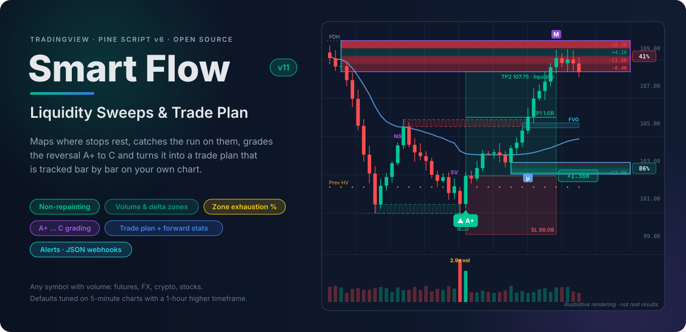
</p>

<p align="center">
  
  
  
  
</p>

<p align="center">
  <b>Where are the stops? Did the market just run them? Is the reversal worth taking — and how did such reversals behave on <i>this</i> chart?</b><br>
  Smart Flow answers all four on one chart, with rules you can read.
</p>

<p align="center">
  <a href="#-quick-start">Quick start</a> ·
  <a href="#-volume-analyser--zone-exhaustion">Volume analyser</a> ·
  <a href="#-sweep-tracker">Sweep tracker</a> ·
  <a href="#-context-engine">Context engine</a> ·
  <a href="#-trade-plan--forward-statistics">Trade plan</a> ·
  <a href="#-alerts">Alerts</a> ·
  <a href="#-honest-limitations">Limitations</a>
</p>

---

## ✦ Why Smart Flow

| | |
|---|---|
| **See the liquidity, not just the levels** | Buy-side and sell-side zones on three structural levels. Each zone shows the volume and estimated delta traded inside it, plus how exhausted it is. |
| **Catch the run on stops** | A sweep needs a break of the recent high or low on elevated volume, then a close back inside within a few bars. Six components score its quality. |
| **Grade before you click** | Five independent context factors give each sweep a grade from A+ to C. Suspicious sweeps drop one grade. |
| **Know the trade, not just the arrow** | Every signal comes with entry, stop, TP1 and TP2. Plans are walked forward bar by bar into on-chart statistics, after your costs. |
| **Trust what you see** | Signals are final on bar close. Higher-timeframe data uses completed bars only. History matches what you would have seen live. |

---

## ⚙ How it works

<p align="center">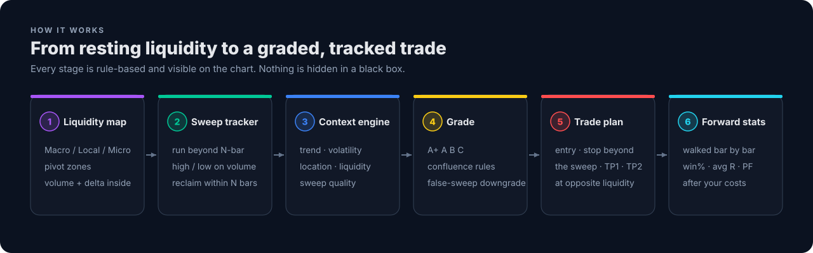</p>

Every stage is plain, rule-based logic. The full source is in [`src/smart_flow_v11.pine`](src/smart_flow_v11.pine).

---

## ◧ Volume analyser & zone exhaustion

<p align="center">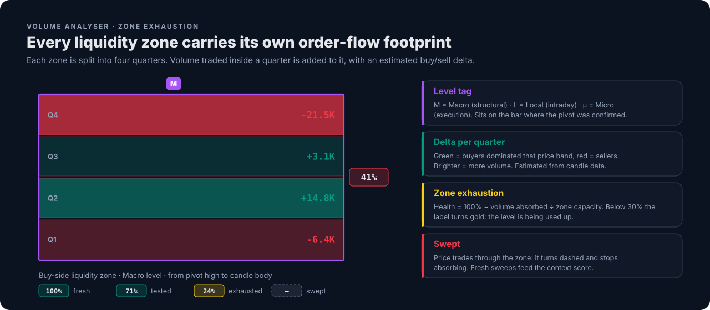</p>

The liquidity profiler turns every confirmed pivot into a zone: from the wick extreme to the candle body. Zones are built on three levels: **Macro** (structural), **Local** (intraday) and **Micro** (execution).

- **Volume & delta quadrants.** The zone is split into four price bands. Each bar adds the part of its volume that traded inside each band, signed by candle direction. The heat map shows where buyers and sellers actually fought.
- **Zone exhaustion.** `health = 100% − absorbed volume ÷ zone capacity`. A level that keeps getting traded into is being used up. Below 30% the label turns gold.
- **Swept state.** When price trades through, the zone turns dashed and stops absorbing. A fresh sweep of the opposite side becomes *fuel* in the context score.
- **Per-level budgets.** Each level keeps its own number of zones, so frequent Micro zones never push structural Macro zones off the chart.

---

## ⤓ Sweep tracker

<p align="center">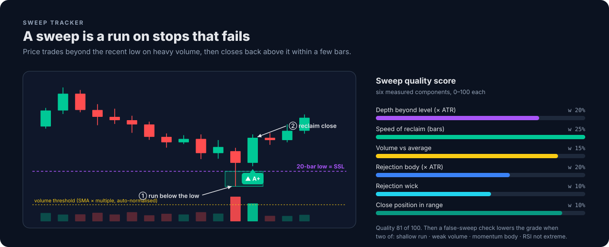</p>

1. **Run.** The previous bar breaks the N-bar low or high, and its volume exceeds the average by a multiple. The multiple adapts to the symbol's volatility percentile.
2. **Reclaim.** Price closes back inside the level within the timeout (4 bars by default).
3. **Quality.** Six components, 0–100 each: depth, speed, volume, rejection body, rejection wick and close position.
4. **False-sweep check.** The grade drops by one when two of four warning signs appear: shallow run, weak volume compared with past sweeps, momentum body, or RSI not extreme at the true sweep extreme.

---

## ◎ Context engine

<p align="center">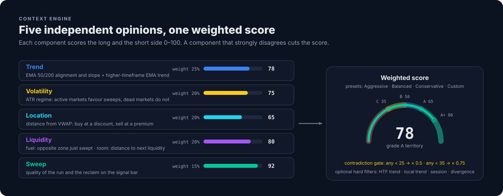</p>

| Component | What it measures |
|---|---|
| **Trend** | EMA 50/200 alignment and slope, plus the EMA trend of the higher timeframe |
| **Volatility** | ATR regime. Sweeps work in active markets and fail in dead ones |
| **Location** | Distance from VWAP: buy at a discount, sell at a premium |
| **Liquidity** | *Fuel*: the opposite zone was just swept. *Room*: distance to the next untouched liquidity in the trade direction |
| **Sweep** | Quality and speed of the run and the reclaim |

Weights come from four presets: Aggressive, Balanced, Conservative or Custom. A component that strongly disagrees (score below 25 or 35) cuts the total. Optional hard filters: higher-timeframe trend, local trend, session window and RSI divergence.

<p align="center">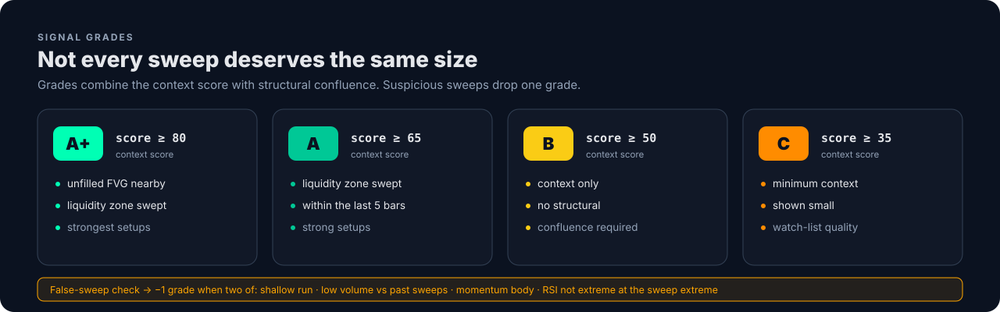</p>

---

## ◩ Trade plan & forward statistics

<p align="center">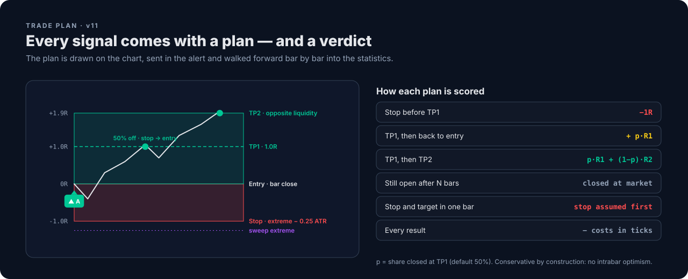</p>

- **Entry** at the close of the signal bar. **Stop** beyond the sweep extreme plus an ATR buffer.
- **TP1** at a fixed R. **TP2** at the nearest untouched opposite liquidity or the previous-day high/low, capped at 5R. If no such level exists, a fixed R is used.
- A partial exit at TP1 (50% by default) moves the stop to entry.
- **Statistics** are reported per grade and for your chosen minimum grade: number of plans, win rate, average R, profit factor and TP1 reach. Costs in ticks are subtracted from every result.
- **Conservative by design.** When the stop and a target fall inside the same bar, the stop is assumed first. Nothing is optimised after the fact.

Hover any signal badge for the full "why": sweep level and extreme, quality breakdown, all five context components, higher-timeframe state, confluence, the false-sweep verdict and the plan.

---

## ▤ Dashboard

<p align="center">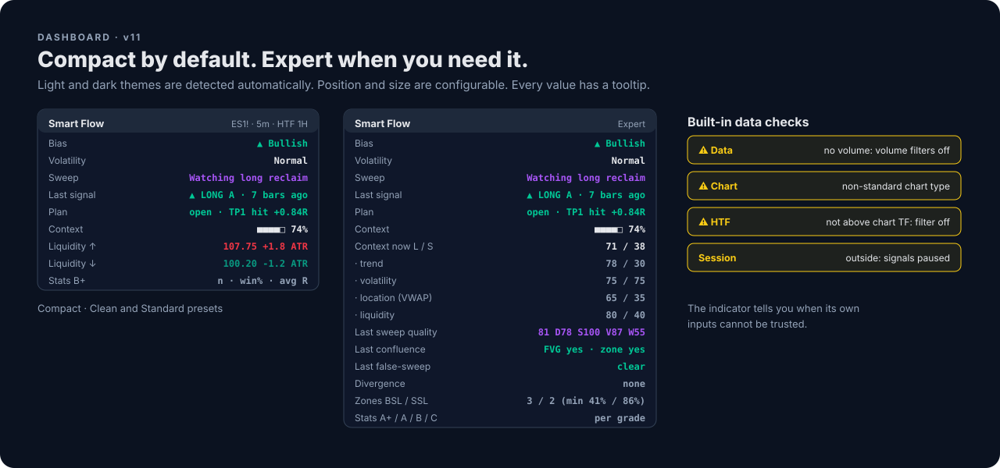</p>

## ◫ Visual presets

<p align="center">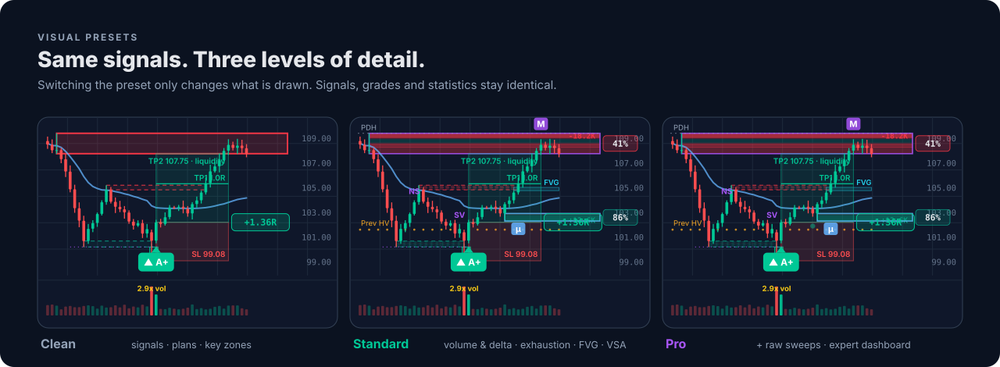</p>

**Standard** is the default. It shows the full liquidity profiler: volume and delta quadrants, zone exhaustion, VSA (stopping volume and no-supply bars), high-volume levels from the previous session, FVG on the chart timeframe and the higher timeframe, and previous-day high/low. Switching presets never changes signals or statistics.

---

## ✓ No repaint, no lookahead

<p align="center">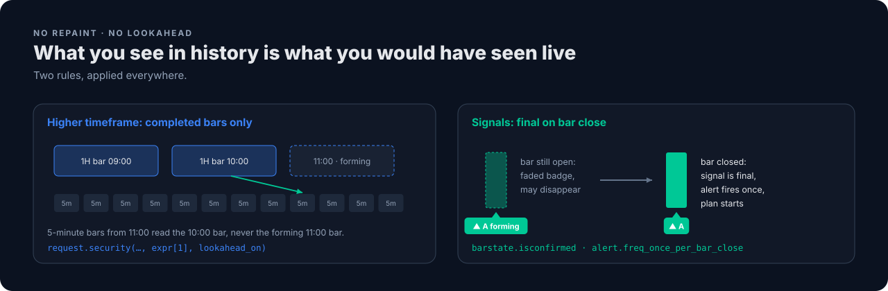</p>

---

## 🔔 Alerts

Create **one** alert with the condition **Smart Flow → Any alert() function call**. It fires once per bar close for:

- new signals at or above your chosen grade, with entry, SL, TP1 and TP2;
- trade-plan events: TP1, TP2, stop, stop at entry, timeout.

Switch *Message format* to **JSON** for webhooks:

```json
{"source":"SmartFlow","event":"signal","ticker":"ES1!","tf":"5","side":"LONG","grade":"A",
 "confidence":74.0,"entry":6021.25,"sl":6015.50,"tp1":6027.00,"tp2":6034.75,"time":1795600800000}
```

Two classic conditions, *Smart Flow long* and *Smart Flow short*, are also available for the standard alert dialog.

---

## 🚀 Quick start

1. Open TradingView → **Pine Editor** → *New blank indicator*. Replace the template with the content of [`src/smart_flow_v11.pine`](src/smart_flow_v11.pine).
2. Click **Save**, then **Add to chart**. Use standard candles.
3. Defaults are tuned for **5-minute charts with a 1-hour higher timeframe**. *Auto* higher timeframe adapts to other chart timeframes: 1m→15m, 15m–1H→4H, 4H→1D.
4. If TradingView reports *"takes too long to execute"*, lower **Calculation depth** (default 2000 bars).

<details>
<summary><b>Settings reference</b></summary>

| Group | Key settings |
|---|---|
| 1 · View | Visual preset, dashboard mode / position / size, calculation depth, drawing window |
| 2 · Signals | Confirm on bar close, minimum grade shown, badge budget |
| 3 · Trade plan | Stop buffer (ATR), TP1 R, TP2 mode and cap, partial %, max bars in trade |
| 4 · Statistics | Summary from grade, round-trip costs in ticks |
| 5 · Higher timeframe | Auto / manual, trend in context score, trend as hard filter, EMA lengths |
| 6 · Session | Session window and time zone |
| 7 · Context engine | Preset weights, minimum score, local-trend filter, liquidity memory, divergence |
| 8 · Grading | A+ / A / B / C thresholds, FVG and zone confluence requirements |
| 9 · Sweep engine | Lookback, volume multiple, reclaim timeout, cooldown |
| 10 · Normalisation | Volatility-adaptive thresholds |
| 11 · False-sweep check | Depth, volume, body and RSI criteria |
| 12 · Liquidity zones | Pivot lengths per level, zones per level, capacity, colours |
| 13 · Fair value gaps | Strength preset, per-side limits, remove on fill |
| 14 · VSA | Markers, colours |
| 15 · Custom layers | Every visual layer individually |
| 16 · Alerts | Signal and plan alerts, minimum grade, text / JSON |

</details>

---

## ⚠ Honest limitations

- **Delta is an estimate** from candle shape. It is not exchange order flow.
- **Pivot zones need confirmation bars.** A zone is drawn from its pivot bar, but it becomes known a few bars later. The level tag marks that bar.
- **Statistics describe the past on one chart.** They use simple, conservative fill rules and are not a forecast or a promise of results.
- **Data checks.** Symbols without volume data turn the volume filters off. Non-standard chart types (Heikin Ashi, Renko and similar) disable plans and statistics. The dashboard warns in both cases.
- **No machine learning.** The context engine is transparent, rule-based scoring.

---

## v10 → v11

<p align="center">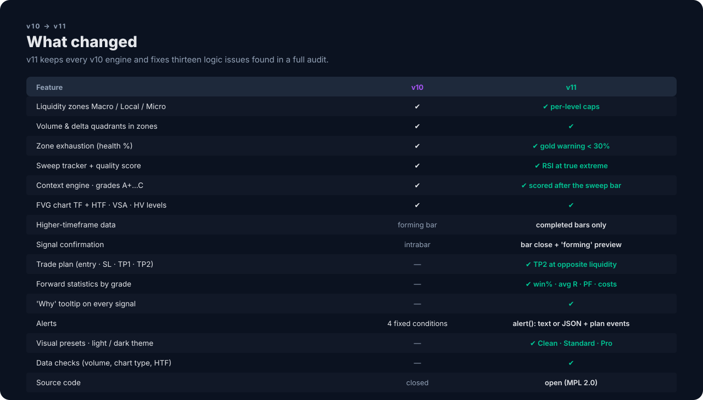</p>

The predecessor is described at **[Smart Flow v10 — Liquidity Engine](https://github.com/sergeyrokossovsky-rgb/smart-flow-v10)**. The full list of changes is in [docs/CHANGELOG.md](docs/CHANGELOG.md).

---

<sub>Smart Flow is an analytical tool, not financial advice. Trading involves substantial risk of loss. The chart images on this page are illustrative renderings, not real results. Source code: Mozilla Public License 2.0.</sub>
